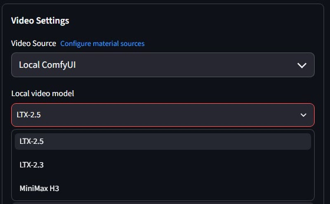
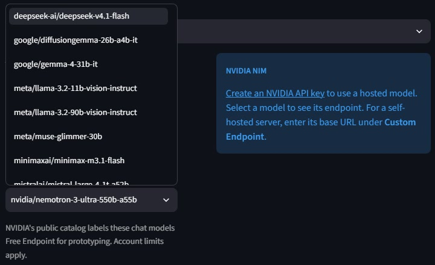

<h1 align="center">MoneyPrinterTurbo + ComfyUI</h1>

<p align="center">
Generate video scenes in <a href="https://github.com/harry0703/MoneyPrinterTurbo">MoneyPrinterTurbo</a> with <strong>LTX-2.5, LTX-2.3 or MiniMax H3</strong> on your own ComfyUI server.<br>
Use your text provider or <a href="docs/setup.md#nvidia-nim">NVIDIA NIM</a> to write scene prompts, review the scenes and download the finished MP4.
</p>

<p align="center">
<a href="https://github.com/ZeroMemory/moneyprinterturbo-comfyui/releases/latest"></a>
<a href="docs/setup.md#installation-options"></a>
<a href="#quick-start"></a>
<a href="https://github.com/ZeroMemory/moneyprinterturbo-comfyui/releases/latest"></a>
</p>

<p align="center">
<a href="#quick-start">Quick start</a> ·
<a href="docs/setup.md">Models &amp; settings</a> ·
<a href="docs/setup.md#manual-scene-editing">Scene editor</a> ·
<a href="docs/workflows.md">Custom workflows</a>
</p>

<table align="center">
<tr><th>Generate video locally</th><th>Plan scenes with NVIDIA NIM</th></tr>
<tr>
<td><a href="docs/images/local-models.jpg"></a></td>
<td><a href="docs/images/nvidia-nim.jpg"></a></td>
</tr>
</table>

## Quick start

**You need:** a working [MoneyPrinterTurbo v1.3.9 installation](https://github.com/harry0703/MoneyPrinterTurbo/blob/v1.3.9/README-en.md), Python 3.11 or later, Git, and FFmpeg with `ffprobe` on your PATH. Use a source checkout, Windows portable MPT or MPT installed with pip in a virtual environment. See [installation options](docs/setup.md#installation-options) for Windows, Linux, macOS and Docker.

You can also use the [supported MPT main checkout](docs/setup.md#use-a-pinned-main-checkout).

The steps below use ComfyUI on the same machine. For a separate machine, see [Remote ComfyUI setup](docs/setup.md#connect-a-separate-comfyui-server).

### 1. Export a local workflow

Download the [LTX-2.5 weights](docs/setup.md#ltx-25) and use a GPU with enough memory for the workflow. Start **ComfyUI 0.43.0** on port `8188` with its default output folder. Open the official local **LTX-2.5** text-to-video template, select the weights, then choose **Export (API)** and save it as `../ltx-2.5.api.json`. Repeat this one-time setup for each model you use. [Workflow export and model options](docs/workflows.md#export-a-local-workflow)

### 2. Install the add-on

Stop MPT and extract the add-on to a folder you can keep. Run this command from that folder with your MPT folder, ComfyUI folder and exported API file.

```text
python install.py install "../MoneyPrinterTurbo" --comfyui "../ComfyUI" --workflow-api "../ltx-2.5.api.json" --model-version 2.5
```

Use `python3` if that is your Python command, or run `.\install.cmd` with the same arguments in PowerShell for Windows portable MPT. The installer finds the weights, checks the running server for required nodes, registers the model and installs the scene editor extension. Restart ComfyUI once to load the editor, then restart MPT.

<details>
<summary>Interactive installer</summary>

Run `python install.py` without arguments, open `install.cmd` on Windows or `install.command` on macOS, or run `sh install.sh` on Linux. Choose **Install or add a model**, enter the MPT and ComfyUI folders, pick a model and enter the path to its API export.

</details>

### 3. Make your video

1. Select a working text provider to write the scene prompts.
2. Set **Video Source → Local ComfyUI**, choose your **Local video model**, and enter a subject or script.
3. Set **Scene duration** and **Maximum scenes**, then click **Generate Video**.
4. In **Scene review**, check the prompts and timing, then click **Send to ComfyUI**.
5. When the task finishes, click **Download Video**.

**Scene audio:** set **Voiceover Mode → None** to keep the generated scenes' sound. Selecting a voice or uploading an audio file uses that track instead.

Without narration or custom audio, your script describes visual action and the director chooses up to the selected number of scenes. With narration, the scenes must cover the measured audio duration. Clips play in plan order. MPT saves the first finished video as `final-1.mp4` in the task's folder under `storage/tasks`. **Recompose video** reuses completed clips when you rebuild the final edit.

**Manual editing:** enable **Edit scenes in ComfyUI** and click **Open scene editor**. Choose a scene in **MPT scenes**, make changes and click **Save scene to MPT**. Return to MPT and click **Load saved edits and start**. Editing does not start generation. See [manual scene editing](docs/setup.md#manual-scene-editing).

## Find your setup

| Task | Guide |
| --- | --- |
| Download weights and connect a model | [Models and settings](docs/setup.md) |
| Use ComfyUI on another machine | [Remote ComfyUI setup](docs/setup.md#connect-a-separate-comfyui-server) |
| Install into portable MPT, a pip environment or Docker | [Installation options](docs/setup.md#installation-options) |
| Adjust resolution or predict LTX-2.5 scene lengths | [Clip sizes](docs/setup.md#clip-sizes) · [Scene timing](docs/setup.md#scene-timing) |
| Choose an NVIDIA text model | [NVIDIA NIM](docs/setup.md#nvidia-nim) |
| Edit scenes on the ComfyUI canvas | [Manual scene editing](docs/setup.md#manual-scene-editing) |
| Use Docker or the MPT API | [Docker and the API](docs/setup.md#docker-and-the-api) |
| Change a workflow or use the operator CLI | [Custom workflows](docs/workflows.md) |

The installer copies the [new MPT files](mpt/) and applies the [changes to existing MPT files](payload/mpt.patch).

## Remove or update

Stop MPT and run this command from the add-on folder.

```text
python install.py uninstall "../MoneyPrinterTurbo"
```

Before upgrading MPT or the add-on, remove the old integration. After the upgrade, register each model's API export again. Scene plans that reference graphs bundled by an earlier release need to be created and approved again.

## License

[MIT](LICENSE), with copyright notices for the add-on and MoneyPrinterTurbo.
