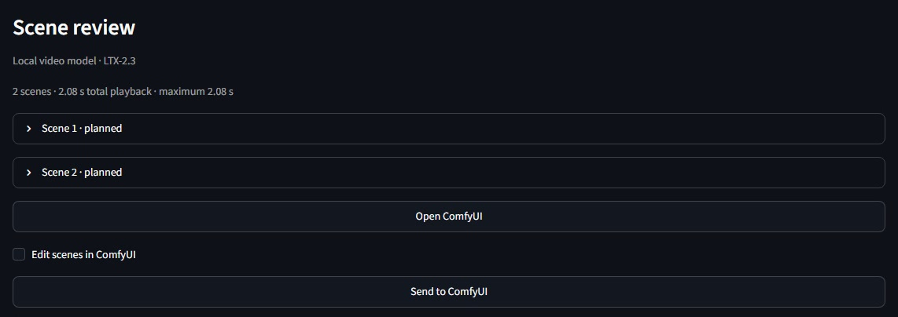
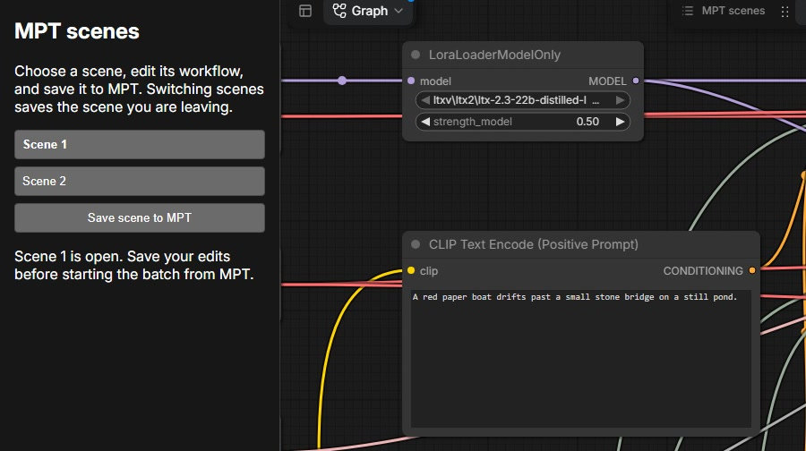
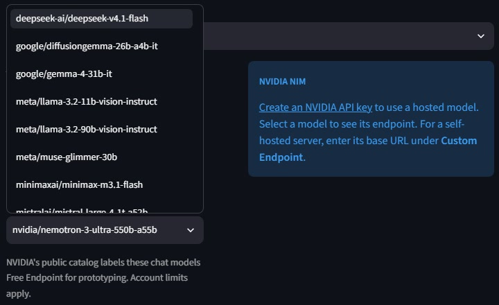

# ComfyUI models and settings

Choose one model and [export its local workflow from ComfyUI](workflows.md#export-a-local-workflow). Select the weight files for your chosen graph before exporting. The example paths below are relative to `ComfyUI/models/`. When downloading or updating weights, check the files against the linked publisher revision. For a fresh MoneyPrinterTurbo checkout, use `git clone --branch v1.3.9 https://github.com/harry0703/MoneyPrinterTurbo.git` and follow the [setup instructions for that version](https://github.com/harry0703/MoneyPrinterTurbo/blob/v1.3.9/README-en.md).

On Windows, the installer stops if an MPT file it needs to replace has a named NTFS stream. Use a fresh Git checkout to keep the original file and its stream intact.

## Installation options

Install MPT first using its own instructions. Stop it before adding or removing the add-on, and keep the extracted add-on folder in place afterward. All native routes need Git and Python 3.11 or newer; FFmpeg and `ffprobe` must be available to MPT. The add-on does not replace MPT's environment, fonts, music or user configuration.

| MPT installation | Add-on entrypoint |
| --- | --- |
| Source on Windows (PowerShell) | `.\install.cmd install "C:\Apps\MoneyPrinterTurbo" --comfyui "C:\Apps\ComfyUI" --workflow-api "C:\Workflows\ltx-2.5.api.json" --model-version 2.5` |
| Source on Linux or macOS | `sh install.sh install "/path/to/MoneyPrinterTurbo" --comfyui "/path/to/ComfyUI" --workflow-api "../ltx-2.5.api.json" --model-version 2.5` |
| Windows portable | Run `.\install.cmd` with the folder containing MPT's `pyproject.toml` and `webui`. The wrapper finds MPT's `.venv` or bundled `lib/python` before global Python. |
| pip in a virtual environment | Pass that environment's Python interpreter, as shown below. |
| Docker (Linux containers) | Use the add-on's [Docker setup](#docker-and-the-api), which builds MPT with the integration included. |

For a pip installation in a virtual environment, run from the add-on folder:

```text
python install.py install --mpt-python "/path/to/mpt-env/bin/python" --comfyui "/path/to/ComfyUI" --workflow-api "../ltx-2.5.api.json" --model-version 2.5
```

In PowerShell, run `.\install.cmd` with the same options and point `--mpt-python` at the environment's `Scripts\python.exe`. You can also pass the virtual-environment folder as the positional MPT path. The installer locates the installed package, updates its package-file inventory and keeps originals for removal. Continue to launch it with `mpt webui` or your existing MPT command.

On macOS, `install.command` also opens the interactive installer. The shell launchers prefer the selected project's `.venv` before `python3`. Use `--mpt-python` when more than one Python environment contains MPT.

Use the original **v1.3.9 release** for portable, pip and Docker installations. Upstream `update.bat` can move a portable installation to newer source that still reports `1.3.9`. The installer checks patch compatibility before replacing files. Before upgrading MPT or the add-on, remove the integration using the same folder or `--mpt-python` selection, then reinstall it into a supported version.

```text
python install.py uninstall --mpt-python "/path/to/mpt-env/bin/python"
```

### Use a pinned main checkout

The add-on also supports the upstream `main` snapshot at commit [`ace6c8f`](https://github.com/harry0703/MoneyPrinterTurbo/commit/ace6c8f3a8dd9508776dbbf6f0bdc9b2d973254a). Clone it with Git and check out that commit before installing.

```text
git clone https://github.com/harry0703/MoneyPrinterTurbo.git
git -C MoneyPrinterTurbo checkout --detach ace6c8f3a8dd9508776dbbf6f0bdc9b2d973254a
```

Install MPT's dependencies from that checkout, then use the source installation command for your platform. The installer uses the clean Git checkout's commit to select the patch.

### Connect a separate ComfyUI server

Start ComfyUI on the machine with the GPU and model weights. Export the model's text-to-video workflow using **Export (API)** and copy the JSON file to the machine running MPT. Stop MPT and install the add-on with your server address:

```text
python install.py install "../MoneyPrinterTurbo" --remote-comfyui https://comfy.example.com --workflow-api "../ltx-2.5.api.json" --model-version 2.5
```

Use `configure` in place of `install` if the add-on is already installed. Use the HTTPS address of a server you manage. If its reverse proxy requires a bearer token, add `--comfyui-token-env MPT_COMFYUI_TOKEN` and set that variable in the environment used by the installer and MPT. For a trusted private IP using plain HTTP, pass `--allow-insecure-comfyui-http`. Restart MPT and use **Local ComfyUI** to select the registered model.

MPT checks the server's nodes and model names, then downloads each finished clip over HTTP into its own task folder. This mode supports text-to-video exports that require no uploaded inputs. Edit the workflow on the ComfyUI server and re-register its API export to change it.

## LTX-2.5

The local two-stage workflow uses ComfyUI 0.43.0's native nodes, including `LTXVDualCFGGuider`. MPT supplies the scene prompt directly, so the importer selects the template's direct text branch. The following five files are a compatible distilled weight set. Select them in ComfyUI before exporting. Sign in to Hugging Face if prompted for access. [Lightricks' LTX-2.5 weights](https://huggingface.co/Lightricks/LTX-2.5/tree/49b093a39c19169a8a81721dcc541e07e945232f)

| Directory | Filename |
| --- | --- |
| `diffusion_models` | `ltx-2.5-22b-distilled-transformer-comfy-int8-convrot.safetensors` |
| `text_encoders` | `gemma4-12b-with-proj-ltx-2.5-comfy-int8-convrot.safetensors` |
| `vae` | `ltx-2.5-video-vae-bf16.safetensors` |
| `vae` | `ltx-2.5-audio-vae-bf16.safetensors` |
| `latent_upscale_models` | `ltx-2.5-latent-spatial-upscaler-x2-bf16-1.0.safetensors` |

If you use the Hugging Face CLI, keep the publisher's directory layout in the download folder and verify the five files there. Then follow the [README](../README.md) to connect ComfyUI and render your first video.

```text
hf cache verify Lightricks/LTX-2.5 --revision 49b093a39c19169a8a81721dcc541e07e945232f --local-dir "/path/to/ltx-2.5-download"
```

In a folder containing only the five listed files, confirm that five files were checked and all checksums match. A warning about other files missing from the full release is expected.

## LTX-2.3

The local template uses the Dev checkpoint with a distillation LoRA, then refines after a 2× latent upscale. The following files are an example FP8 checkpoint and FP4 Gemma setup. For this weight set, select the listed rank-384 file in the LoRA loader before exporting. MPT supplies the scene prompt through the direct text branch. [ComfyUI's local LTX-2.3 template](https://github.com/Comfy-Org/workflow_templates/blob/main/templates/video_ltx2_3_t2v.json)

| Directory | Filename | Download |
| --- | --- | --- |
| `checkpoints` | `ltx-2.3-22b-dev-fp8.safetensors` | [Lightricks FP8 checkpoints](https://huggingface.co/Lightricks/LTX-2.3-fp8/tree/91eda216f820e5ecb3d17dc9fe3b7cdaf56b587d) |
| `text_encoders` | `gemma_3_12B_it_fp4_mixed.safetensors` | [Comfy-Org text encoders](https://huggingface.co/Comfy-Org/ltx-2/tree/ccde4ba417d7900669fd56dd292a883cee11ff37/split_files/text_encoders) |
| `latent_upscale_models` | `ltx-2.3-spatial-upscaler-x2-1.1.safetensors` | [Lightricks LTX-2.3 weights](https://huggingface.co/Lightricks/LTX-2.3/tree/c1521179de480464f366a98a9d9b2acc4cc097b9) |
| `loras` | `ltx-2.3-22b-distilled-lora-384-1.1.safetensors` | [Lightricks LTX-2.3 weights](https://huggingface.co/Lightricks/LTX-2.3/tree/c1521179de480464f366a98a9d9b2acc4cc097b9) |

Export the graph as `../ltx-2.3.api.json`. Stop MPT, leave ComfyUI running and select LTX-2.3 during interactive installation, or run this command from the add-on folder with your local paths.

```text
python install.py install "../MoneyPrinterTurbo" --comfyui "../ComfyUI" --workflow-api "../ltx-2.3.api.json" --model-version 2.3
```

Rerun the command after changing model files. Existing scene plans reference their original workflow and weights. Create and review a new plan to use the new configuration.

If sampling with this checkpoint and LoRA produces invalid values on AMD ROCm, try [LTX-2.5](#ltx-25).

For Windows crashes in `safetensors.get_tensor` while loading large checkpoints, see the [upstream ComfyUI report and loader workarounds](https://github.com/Comfy-Org/ComfyUI/issues/15424).

## MiniMax H3

Choose a scene duration of 4–15 seconds for H3-Base FL2VA. It generates at 24 fps, including sound. With **Voiceover Mode: None**, MPT keeps the scenes' sound. Narration or uploaded audio replaces that track; optional background music is mixed into the final edit. [MiniMax H3 model card](https://huggingface.co/MiniMaxAI/MiniMax-H3)

Select Base or Turbo in ComfyUI before exporting. The importer keeps the selected branch, so install the weights that branch uses. The following four files are a local H3-Base FL2VA weight set. [Comfy Org H3 weights](https://huggingface.co/Comfy-Org/MiniMax-H3/tree/912b6e38b2092ec4d2e86d24183e0d59ea059d48)

| Directory | Filename |
| --- | --- |
| `diffusion_models` | `minimax_h3_fl2va_pruned_int8_convrot.safetensors` |
| `text_encoders` | `qwen3vl_32b_minimax_h3_nvfp4_awq.safetensors` |
| `vae` | `minimax_h3_video_vae_int8_convrot.safetensors` |
| `vae` | `minimax_h3_audio_vae_fp32.safetensors` |

Export the graph as `../h3.api.json`. Start ComfyUI with the weights in place, stop MPT and select MiniMax H3 during interactive installation, or run this command from the add-on folder with your local paths.

```text
python install.py install "../MoneyPrinterTurbo" --comfyui "../ComfyUI" --workflow-api "../h3.api.json" --model-version h3
```

## Connection settings

- Point `--comfyui` at a source or portable ComfyUI installation. Use its default output directory, `ComfyUI/output`. Pass `--comfy-python` if its interpreter is outside the usual virtual environment.
- The default endpoint is `http://127.0.0.1:8188`. Use `--endpoint` for another local port. Pass `--model-root` for each extra model root already registered in ComfyUI. Give different files distinct names or subfolders within each model category, including the legacy `models/unet` and `models/clip` folders. In interactive setup you can enter a model root or Python interpreter when the installer cannot find it.
- To add another model, rerun the install command with its `--workflow-api` and `--model-version`. The installer makes it the default and keeps previously registered models. The WebUI remembers your last choice when that model is still available. Switch **Local video model** to use the new one. Keep the add-on folder in place and update any paths you set explicitly in MPT's own configuration.
- After installing the add-on, run `python install.py configure "../MoneyPrinterTurbo" --request-template "../scene-settings/custom.json"` to register a [custom request template](workflows.md#executable-request). Keep the request and its referenced files in place.
- To reuse loaders across queued scenes, leave node caching and smart memory management enabled in ComfyUI. Avoid `--cache-none` and `--disable-smart-memory`. ComfyUI can offload weights to fit the available memory.
- For final editing, allow temporary space in MPT’s task directory for one copy of the scene clips. MPT checks their recorded hashes while copying so later changes to the originals cannot alter that edit.
- If a template from an older installation uses an external model directory, register the model again with `--model-root` so its profile records that directory.

## Clip sizes

Choose an aspect ratio and **Generated clip size** in MPT. The bold size is the initial selection. Portrait swaps width and height. **Custom** accepts other dimensions, and MPT remembers your selection per model and aspect ratio.

| Model | Landscape | Square |
| --- | --- | --- |
| LTX-2.3 and LTX-2.5 | 1024×576, 1280×704, **1920×1088** | 576×576, 704×704, **1088×1088** |
| MiniMax H3 | 960×544, 1024×576, **1344×768** | **768×768** |

LTX renders at half the selected width and height, then upscales 2×. The default follows the two-stage reference workflows. The other sizes follow Lightricks' local pixel map. [LTX-2.3 workflow](https://github.com/Lightricks/ComfyUI-LTXVideo/blob/220e1d45aa0469f518e982102fca4dca92a61862/example_workflows/2.3/LTX-2.3_T2V_I2V_Two_Stage_Distilled.json) · [LTX-2.5 two-stage example](https://huggingface.co/Lightricks/LTX-2.5#image-to-video-two-stages) · [Lightricks pixel map](https://github.com/Lightricks/LTX-Desktop/blob/8ffed888f3a9afdfbf137fa6193bf1cdc1cd657b/backend/runtime_config/ltx_capabilities.py)

H3 renders directly at the selected size. Its base model defaults to a 768-pixel short edge. The smaller landscape sizes come from local inference examples. [MiniMax defaults](https://huggingface.co/MiniMaxAI/MiniMax-H3#system-overview) · [Diffusers memory guide](https://github.com/huggingface/diffusers/blob/main/docs/source/en/api/pipelines/minimax_h3.md#memory) · [vLLM H3 recipe](https://recipes.vllm.ai/MiniMaxAI/MiniMax-H3#known-limitations)

## Scene timing

**Scene duration** sets the duration of each generated scene. The model's frame rules can round it to a nearby value; MPT shows the resulting duration. **Maximum scenes** is an upper limit. The total playback budget is the maximum scene count multiplied by the rounded scene duration, divided by **Video speed**.

With **Voiceover Mode: None** and no custom audio, **Video Script** is a visual screenplay. The director can choose one scene or more, up to your limit. The finished video lasts as long as those scenes at the selected speed; the length of the text does not set its duration. Visual descriptions do not become automatic subtitles.

MPT preserves the scenes' audio in this mode and applies **Video speed** to both picture and sound. Silent scenes and short audio tails leave gaps without shifting later scenes. Optional background music is mixed with this track. A voiceover or uploaded audio replaces the generated scene audio.

With generated narration or custom audio, MPT measures the audio and calculates how many scenes are needed. If the scene limit cannot cover it, MPT shows the required count before planning or rendering. Increase the limit or duration, reduce the speed, or shorten the audio. The final scene ends with the audio.

Local scenes stay in plan order and use their complete clips before the final audio-length trim. The stock footage controls for random order and maximum clip duration do not apply to them. Scene review shows the planned count and playback duration before approval.

For LTX-2.5 without narration or uploaded audio, **Predict scene duration (LTX-2.5)** lets the local model choose each scene's length. Sign in to Hugging Face to download `ltx-2.5-duration-head-bf16.safetensors` from the [Lightricks model patches folder](https://huggingface.co/Lightricks/LTX-2.5/tree/main/model_patches). Save it in `ComfyUI/models/model_patches/`. ComfyUI must provide `LTXVDurationPredictor`, `ModelPatchLoader` and `PreviewAny`. In this mode, **Scene duration** is the maximum; frame counts round down to stay within it. At 24 FPS, a 3-second cap allows up to 65 frames (2.71 seconds). Prediction loads the text encoder and model but does not render video. The resolved lengths appear in Scene review and are fixed before approval. Leave the option off for fixed-duration scenes or narration.

## Manual scene editing

**Send to ComfyUI** sends the reviewed scene batch in one click. **Open ComfyUI** opens the server without changing the task. For canvas editing before generation, enable **Edit scenes in ComfyUI** instead and open the scene editor. The **MPT scenes** sidebar lists that task's scenes. Choose one to open its graph, edit it and click **Save scene to MPT**. Switching with the MPT scenes buttons also saves your current scene. Return to MPT and click **Load saved edits and start** to validate all saved graphs and start the batch. Unedited scenes keep their original graph. Turning the editing option off returns to the original plans and keeps the saved drafts for reopening.

<a href="images/scene-review.jpg"></a>

<a href="images/comfyui-scene-editor.jpg"></a>

The installer places `mpt_scene_editor` in `ComfyUI/custom_nodes`. Restart ComfyUI after the first installation and allow this pack if you use a custom-node whitelist. If editor setup fails, ordinary MPT generation still works and the installer reports the reason. The reusable ComfyUI pack stays installed when you remove the MPT integration.

The editor uses ComfyUI's single-user storage. Saved edits stay on the local ComfyUI server. Native Run and autoqueue do not submit an MPT draft; start the batch from MPT. Other ComfyUI workflows keep their usual controls. Keep the scene's original SaveVideo nodes and direct prompt, seed, dimension and frame controls. Enter new seeds between 0 and 9,007,199,254,740,991 in the browser, which may display larger existing seeds rounded even though MPT preserves their exact values. New weights must be in the registered model roots; input media must be in ComfyUI's input directory. MPT creates new plans for the edited graphs and checks that narrated scenes still cover their audio. Different scene sizes are fitted to MPT's selected final video size.

## NVIDIA NIM

Choose **NVIDIA NIM** in MPT's text-model settings to use it for scene planning. The hosted catalog shows live model IDs that NVIDIA labels **Chat** and **Free Endpoint**. Browsing requires no key. For hosted inference, enter your NVIDIA key in MPT or set `NVIDIA_API_KEY`. [NVIDIA access terms](https://docs.api.nvidia.com/nim/docs/product)

<a href="images/nvidia-nim.jpg"></a>

Select a model to see its **Chat endpoint**. MPT reads the model's NVIDIA specification and sends scene prompts to its documented text API. For example, GPT-OSS 20B supports the Responses API, while MiniMax M3.1 Flash uses Chat Completions. **Refresh NVIDIA Catalog** reloads the model list and clears cached routes. If MPT cannot verify a hosted model's endpoint, it keeps the selection and shows a warning.

Script replies stream into **Video Script**. Scene-plan replies stream into **Scene director response** while preserving your script, even with task logs hidden. Scene Director allows up to 600 seconds of network inactivity per request. Each planning attempt is shown in the log.

Use **Stop all** in the top bar to cancel active text requests and queued video tasks in the current MPT process. Saved scripts and completed clips stay in place. Native encoding and other synchronous stages finish their current operation before stopping. Remote scene cancellation uses the task's signed run record; MPT reports when the server cannot confirm it. **Open task** in the task list returns to scene review for an available local-video task, including completed or stopped tasks. Rendering stays disabled while a scene is queued or its remote stop is unconfirmed.

If the operator crashes or times out, MPT also checks its owned jobs. When their completion or cancellation cannot be confirmed, the task shows `stop_unconfirmed` and rendering stays disabled; check those jobs in ComfyUI before another attempt.

An interrupted attempt that cannot be resumed asks you to create a new task and review its plans; existing files are kept. Checking a large batch can take a few minutes when the server does not respond.

With MPT's default in-memory state backend, restarting MPT does not resume active workers or restore their runtime state. Task history can restore saved input settings; completed files remain in the task directory.

To replace one clip in a completed video, use **Open task** while its task state is available, then expand **Rerender one scene**. Select the scene, edit its visual prompt or seed, and click **Rerender and recompose**. MPT generates only the selected clip, then assembles a new MP4 using the other clips. The previous MP4 stays in the task folder. With the default in-memory backend, this action is unavailable after restarting MPT.

**Check all models** sends one short text request to each model in the hosted catalog using your NVIDIA key. MPT starts the checks together and stops waiting after 50 seconds. Results appear as each model responds. Click a model's row to select it for scene planning.

For a self-hosted OpenAI-compatible server, enter its base URL under **Custom Endpoint** and type its model ID. If the server requires authentication, enter its key in that section. The key is saved for that URL. Leave the field empty for a server that accepts requests without authentication. If you saved a custom key in the old shared **API Key** field, re-enter it under **Custom Endpoint** and clear or replace the old value before using hosted NIM.

## Docker and the API

The add-on includes a [Dockerfile](../docker/Dockerfile) and [Compose setup](../docker/compose.yaml). They build the original MPT v1.3.9 release with the integration installed. ComfyUI continues to run on the host and use its GPU; the container runs MPT, the operator and final video editing. No model weights are included in the image.

Use Linux containers and Docker Compose. On Windows or macOS, Docker Desktop **4.34 or newer** requires **Settings → Resources → Network → Enable host networking**; Enhanced Container Isolation must be off for this mode. Linux Docker Engine supports host networking directly. See [Docker's platform requirements](https://docs.docker.com/engine/network/drivers/host/).

Copy `docker/.env.example` to `docker/.env`. Set `COMFYUI_DIR` to the host folder containing `main.py`, including the inner `ComfyUI` folder for a portable installation. Use forward slashes in Windows paths. Enclose paths containing a literal `$` in single quotes, as in `COMFYUI_DIR='C:/Apps/Comfy$Studio'`. Set `MPT_DATA_DIR` to a persistent data folder for MPT's config, tasks and resources. Inside that folder, create `workflows` and save the API export for each model you want to register as `2.5.api.json`, `2.3.api.json` or `h3.api.json`. In `docker/.env`, set `MPT_MODELS` to the models whose exports and weights are ready, for example `MPT_MODELS=2.5,2.3,h3`. Set `COMFYUI_MODELS_DIR` if the host server uses a separate category-based model folder. Start ComfyUI, then run from the add-on folder.

```text
docker compose --env-file docker/.env -f docker/compose.yaml up --build
```

Open `http://127.0.0.1:8501`. ComfyUI's root and models are mounted read-only. The installer adds the scene editor to the writable `custom_nodes` folder. Restart ComfyUI once afterward. The output folder remains readable at the same mounted location for video handoff. Docker Desktop must allow access to these host folders.

If ComfyUI is offline or a workflow export or weight file is missing, container startup reports which model could not be registered and still opens MPT for its other video sources and text providers. Fix the reported issue, then restart the container to register that model. Registrations and their workflow snapshots stay in `.ltx-models` under `MPT_DATA_DIR` across container replacement. When upgrading from an older container, start ComfyUI and keep the exports available for the first launch to populate this registry.

The container uses host networking and loopback for both MPT and ComfyUI. Its profile treats ComfyUI as externally managed: it never launches the host's Python or starts or stops that server. Ordinary native installations keep their local interpreter checks. Use a container-specific MPT data folder if an existing config contains host-only paths under `[ltx]`.

To run the original API or CLI instead of the WebUI:

```text
docker compose --env-file docker/.env -f docker/compose.yaml run --rm mpt api
docker compose --env-file docker/.env -f docker/compose.yaml run --rm mpt cli --help
```

The stock MPT `docker-compose.release.yml` uses a prebuilt image and mounts only config and storage; patching a host source folder cannot change that image. Stock source Compose mounts the source tree but does not translate a host ComfyUI profile's paths. Use the add-on Compose file for this local-generation setup.

For the MPT API, native installations default to `127.0.0.1` and retain any existing top-level `listen_host` in `config.toml`. Set `MPT_LISTEN_HOST` to override it. A non-loopback bind requires an API key. The add-on container also defaults to loopback, on API port 8080 or WebUI port 8501.

Set `MPT_API_KEY` in the API process environment, or `api_key` under `[app]` in MPT's persistent config. Send it in the `x-api-key` header. For browser clients on another origin, set `CORS_ALLOWED_ORIGINS` in the API process environment. With Docker, pass these variables explicitly using `docker compose run -e MPT_API_KEY -e CORS_ALLOWED_ORIGINS --rm mpt api` with the same Compose file and env-file options.

With LTX-2.5 and a text provider configured, send this JSON body to `POST /api/v1/videos` to create a task without narration, background music or subtitles.

```json
{
  "video_subject": "Paper boats",
  "video_script": "A red paper boat drifts across a pond.",
  "video_source": "ltx",
  "ltx_model_version": "2.5",
  "match_materials_to_script": true,
  "voice_name": "no-voice",
  "bgm_type": "",
  "subtitle_enabled": false
}
```

Use the returned `data.task_id` in the following requests.

| Method and path | When to use it |
| --- | --- |
| `GET /api/v1/tasks/{task_id}` | Wait for `data.phase` to reach `awaiting_approval`. |
| `GET /api/v1/tasks/{task_id}/ltx/plans` | Review each returned `data.scenes` entry. Keep its `index` and `plan.approval_hash` together. |
| `POST /api/v1/tasks/{task_id}/ltx/approvals` | Send `{"approvals":[{"scene_index":1,"approval_hash":"hash-from-reviewed-plan"}]}` with the actual index and hash for every reviewed scene. A stale plan returns HTTP 409. Read the plans again before approving. |
| `POST /api/v1/tasks/{task_id}/ltx/render` | Start rendering the approved batch. |
| `GET /api/v1/tasks/{task_id}` | After completion, read the final video URLs from `data.videos`. |

If an approved job remains `queued` after an unexpected shutdown of the Redis-backed API, retry it with `POST /api/v1/tasks/{task_id}/ltx/render`. The API rejects the retry while a worker still owns the render slot.
